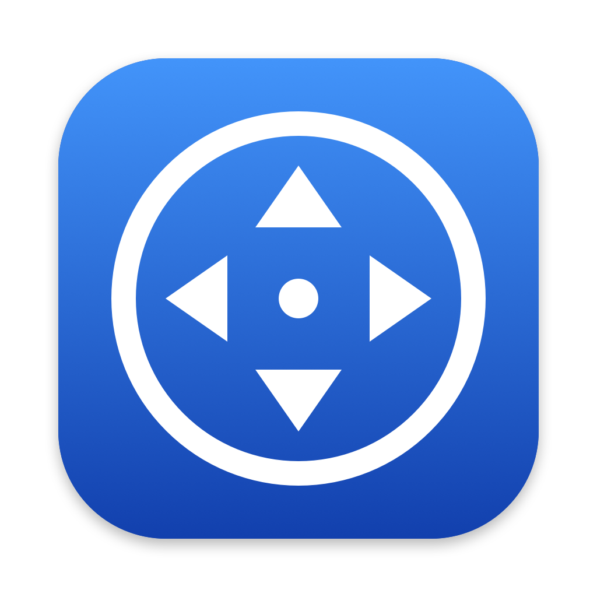

# AnyScroll for Mac



**Windows-style auto-scroll in any direction.**

Press the middle mouse button where you want to scroll and an anchor appears.
Move the pointer away from it and the page scrolls by itself: the further you
go, the faster it scrolls. Click any button or press Esc to stop. Your fingers rest; no
wheel to roll, nothing to hold down.

## Features

- **Visible anchor** where auto-scroll starts, with the active direction highlighted.
- **Click or hold**: a quick click keeps scrolling until you click again; or
  hold the button while you move and let go to stop (can be turned off).
- **Up and down, or any direction**: turn on horizontal scrolling to also
  scroll sideways and diagonally.
- **Clicks stay with AnyScroll**: the click that starts or stops scrolling never
  reaches the app underneath, so it does not open links or press buttons.
- **Smooth**: each pixel is sent when it is due rather than in step with the
  display, so pages move evenly; the slowest speed is one pixel per frame at
  60 Hz, below which whole-pixel steps would show.
- **Stays on its window**: auto-scroll belongs to the window it started in; if
  the pointer leaves it, scrolling pauses until it comes back, so another app
  is never scrolled by mistake.
- **Full speed near window edges**: the speed builds up sooner when there is
  little room left to move the pointer.
- **Choose how to start**: middle click, Shift/Cmd/Option + middle click,
  double middle click, or a side button. Optionally a two-finger trackpad
  scroll while holding keys of your choice, such as Option or Cmd.
- **Keyboard shortcut**: record your own or pick a suggestion to start and stop
  auto-scroll at the pointer, handy with a Magic Mouse or a trackpad. It uses
  the system hot-key service, so AnyScroll never reads what you type.
- **Per-app directions**: choose vertical, horizontal or both for specific apps
  (say, both in a spreadsheet, horizontal only in a timeline); the others follow
  the general setting.
- **Exclude apps** that use the middle button themselves, such as panning in
  design or 3D apps: AnyScroll leaves the click to them.
- **Adjustable speed** (0.2x to 3.0x), natural scrolling, open at login.
- **Never goes online**: no network access, no data collected or sent.
- Light: about 30 MB of memory and no CPU while idle.

## Requirements

- macOS 13 Ventura or later, on Apple Silicon or Intel (universal app).
- A mouse with a middle button or side buttons (or a trackpad, with the
  trackpad keys option).
- Accessibility permission, which macOS asks for on first launch
  (System Settings › Privacy & Security › Accessibility). AnyScroll needs it to
  see the clicks that start and stop scrolling and to send scroll events.

## Install

1. Download the latest **AnyScroll-<version>.dmg** from the
   [Releases](https://github.com/Andrea79/AnyScroll/releases) page and open it.
2. Drag **AnyScroll** onto the **Applications** folder next to it.
3. Open AnyScroll. It is not notarized by Apple, so the first time macOS may
   refuse to open it: go to **System Settings › Privacy & Security**, scroll
   down and click **Open Anyway** (on macOS 13 and 14 you can also Control-click
   the app and choose **Open**).
4. When asked, allow AnyScroll in **System Settings › Privacy & Security ›
   Accessibility**.

AnyScroll lives in the menu bar; Settings and About are in its menu. A zip of
the app is on the Releases page too. After installing a new version, allow it
in Accessibility again.

## Build

The app builds with the Swift compiler from Xcode; no Xcode project is needed.

```bash
./scripts/build_dev.sh release   # build/release/AnyScroll.app, to install
./scripts/build_dev.sh           # build/dev/AnyScroll Dev.app, for testing
```

The Dev build has its own bundle id, so it can run next to the installed app
with separate settings, and writes diagnostics to `~/Library/Logs/AnyScroll Dev.log`. The builds are signed ad hoc: after each rebuild macOS
treats the app as new and Accessibility must be granted again.

To redraw the app icon at every size: `swift scripts/make_icon.swift`.
To measure CPU, wakeups, energy and memory of the running app:
`./scripts/profile.sh 30 idle` (start auto-scroll while it runs to measure scrolling).
For a repeatable comparison between versions, `./scripts/bench.sh` runs the Dev
build with a scripted pointer on every screen and appends the results to
`bench/results.csv`, which stays on your Mac (it is not tracked by git).
To measure how smoothly a page scrolls, open `scripts/smoothness.html` in a
browser (or paste `scripts/smoothness.js` into the console of any page) and
auto-scroll over it; `./scripts/smoothness.sh` scrolls it at constant speeds with
AnyScroll and other engines, for comparison (the Dev build needs Accessibility).

## How it was made

AnyScroll was made by Andrea79 with [Claude Code](https://claude.com/claude-code),
Anthropic's AI coding assistant. All of the code, including the tools in
`scripts/`, was written by Claude under Andrea79's direction. Andrea79 came up
with the idea, made the design decisions, and tested and debugged the app on
real hardware. Commits written with Claude carry a `Co-Authored-By: Claude` line.

## Credits and license

AnyScroll is based on [Scrollapp](https://github.com/fromis-9/scrollapp) by
fromis-9, and was modified by Andrea79 in 2026: new anchor indicator,
four-direction scrolling, a rewritten scroll engine, new icon, About and
Settings windows.

Free software under the [GNU General Public License v3.0](LICENSE).
